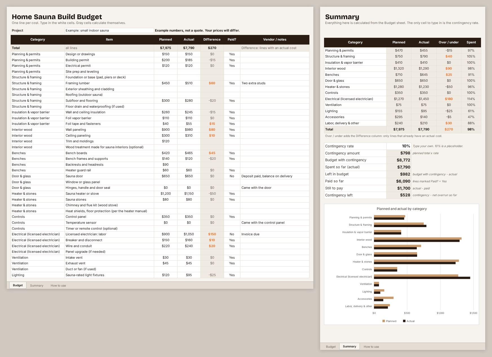
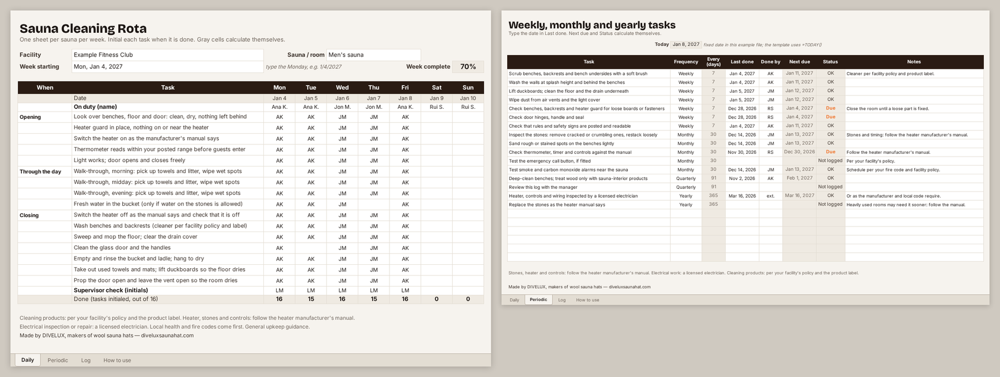
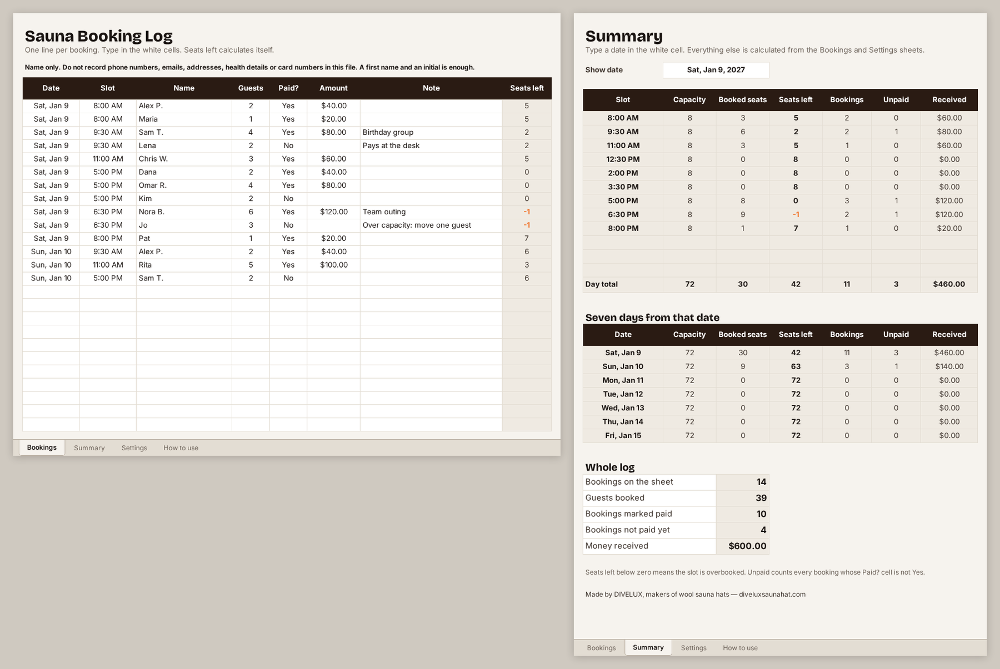

# Free sauna spreadsheet and Notion templates

Five free templates for people who build, own or run a sauna. Four are spreadsheets that open in Excel, Google Sheets,
Numbers and LibreOffice; one is a Notion page with its import files. Every folder has the template, a CSV, a `preview.png`,
a `README.md` and a `LISTING.md` with ready-to-paste title, descriptions, tags and license. Free to use and share under CC BY 4.0.

Made by DIVELUX, makers of wool sauna hats: https://diveluxsaunahat.com ·
more free tools: https://diveluxsaunahat.com/pages/sauna-tools

| # | Template | Preview | Format | Files |
|---|---|---|---|---|
| 1 | [Home Sauna Build Budget](home-sauna-build-budget/) |  | Spreadsheet (.xlsx) + CSV | [`home-sauna-build-budget.xlsx`](home-sauna-build-budget/home-sauna-build-budget.xlsx) [`home-sauna-build-budget-example.xlsx`](home-sauna-build-budget/home-sauna-build-budget-example.xlsx) [`home-sauna-build-budget.csv`](home-sauna-build-budget/home-sauna-build-budget.csv) |
| 2 | [Sauna Heater Sizing Sheet](sauna-heater-sizing-sheet/) |  | Spreadsheet (.xlsx) + CSV | [`sauna-heater-sizing-sheet.xlsx`](sauna-heater-sizing-sheet/sauna-heater-sizing-sheet.xlsx) [`sauna-heater-sizing-sheet-examples.csv`](sauna-heater-sizing-sheet/sauna-heater-sizing-sheet-examples.csv) |
| 3 | [Sauna Cleaning Rota for gyms and spas](sauna-cleaning-rota/) |  | Spreadsheet (.xlsx) + CSV | [`sauna-cleaning-rota.xlsx`](sauna-cleaning-rota/sauna-cleaning-rota.xlsx) [`sauna-cleaning-rota-example.xlsx`](sauna-cleaning-rota/sauna-cleaning-rota-example.xlsx) [`sauna-cleaning-rota-tasks.csv`](sauna-cleaning-rota/sauna-cleaning-rota-tasks.csv) |
| 4 | [Sauna Booking Log for clubs](sauna-booking-log/) |  | Spreadsheet (.xlsx) + CSV | [`sauna-booking-log.xlsx`](sauna-booking-log/sauna-booking-log.xlsx) [`sauna-booking-log-example.xlsx`](sauna-booking-log/sauna-booking-log-example.xlsx) [`sauna-booking-log.csv`](sauna-booking-log/sauna-booking-log.csv) |
| 5 | [Notion: Home sauna: upkeep and costs](notion-home-sauna-upkeep-costs/) |  | Notion build notes (.md) + 2 CSV | [`notion-template.md`](notion-home-sauna-upkeep-costs/notion-template.md) [`upkeep-tasks.csv`](notion-home-sauna-upkeep-costs/upkeep-tasks.csv) [`costs.csv`](notion-home-sauna-upkeep-costs/costs.csv) |

## Using the spreadsheets

- White cells are for typing. Gray cells calculate themselves; leave them alone.
- Each workbook has a "How to use" sheet. Files ending in `-example.xlsx` show the template filled in with sample data (made-up names and numbers).
- Google Sheets: upload the `.xlsx` to Google Drive, open it, then File → Save as Google Sheets. Check the drop-downs once after the conversion (and the chart in the budget file).
- The fonts named in the files are Bricolage Grotesque and Inter (SIL Open Font License 1.1). Without them installed, your spreadsheet program picks a default font and everything still works.
- Every sheet is set up to print on US Letter.

## License

CC BY 4.0 (Creative Commons Attribution 4.0 International). Credit: DIVELUX, https://diveluxsaunahat.com
The DIVELUX name and logo are © DIVELUX Inc. and are not covered by the license.

Every sheet carries the credit line "Made by DIVELUX, makers of wool sauna hats — diveluxsaunahat.com" with a link. Please keep it when you share or adapt the files.

## Rebuilding

Sources live in `_build/`. `python3 _build/build_templates.py` writes the workbooks and CSVs with openpyxl, recalculates every
workbook with the Python package `formulas` and fails on any Excel error value, compares the key totals with an independent
calculation (the heater sheet also against `heater.js` of the online calculator and the manufacturers' worked examples), and draws
the previews with Playwright (one Chromium at a time, under `flock /tmp/freebies-chromium.lock`). `--no-preview` skips the images.
`python3 _build/listings.py` rewrites the LISTING.md and README.md files and checks the length limits.

The previews are renderings of the real workbook cells, not screenshots of Excel. The Notion preview is a layout mockup.

General information: not professional, electrical or medical advice. Electrical work is for a licensed electrician; for heaters,
follow the manufacturer's manual.
