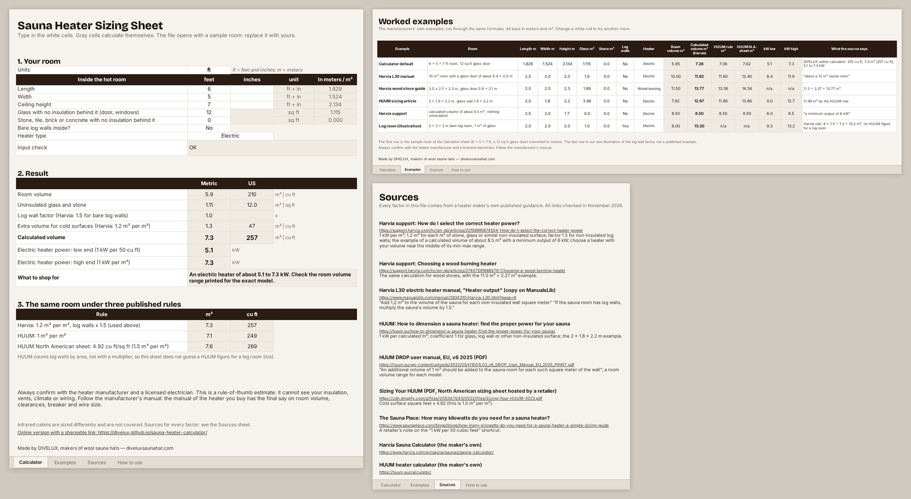
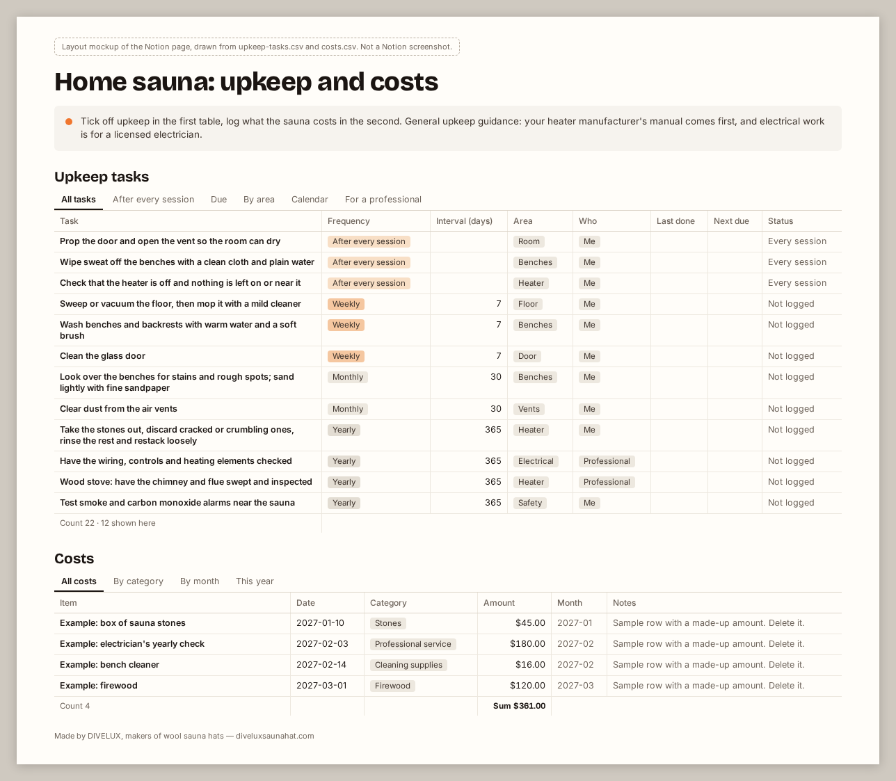
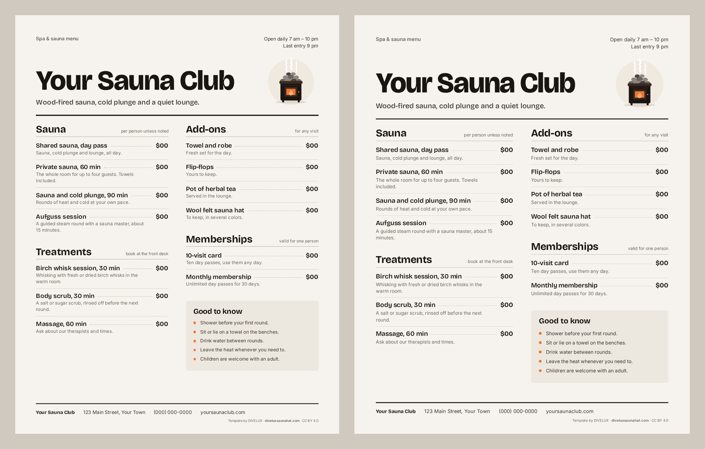
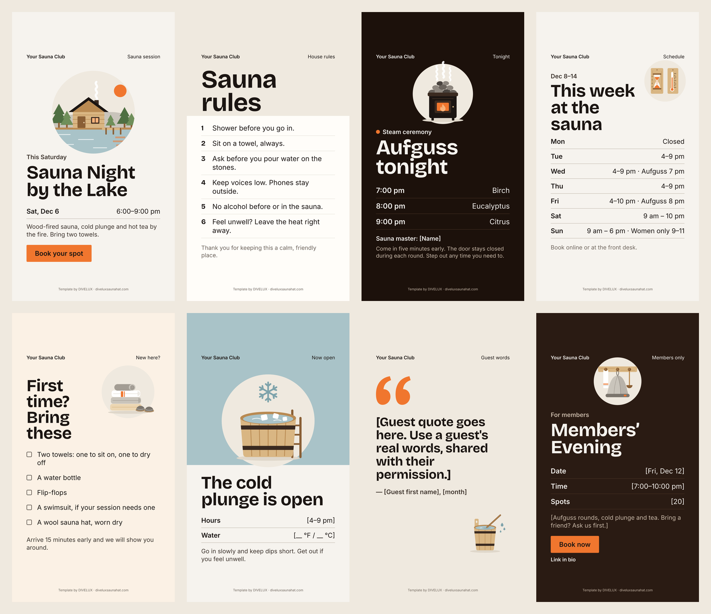
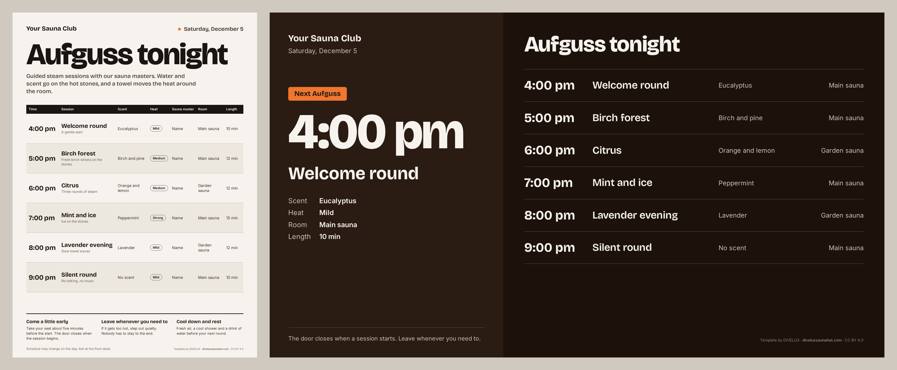
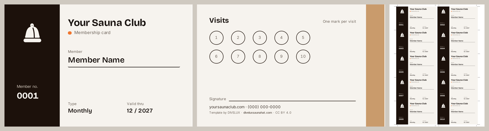
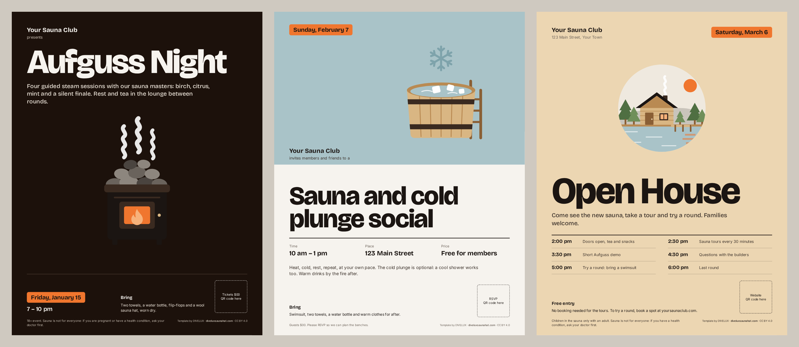
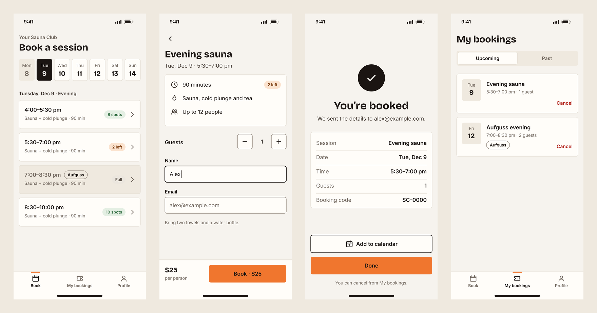
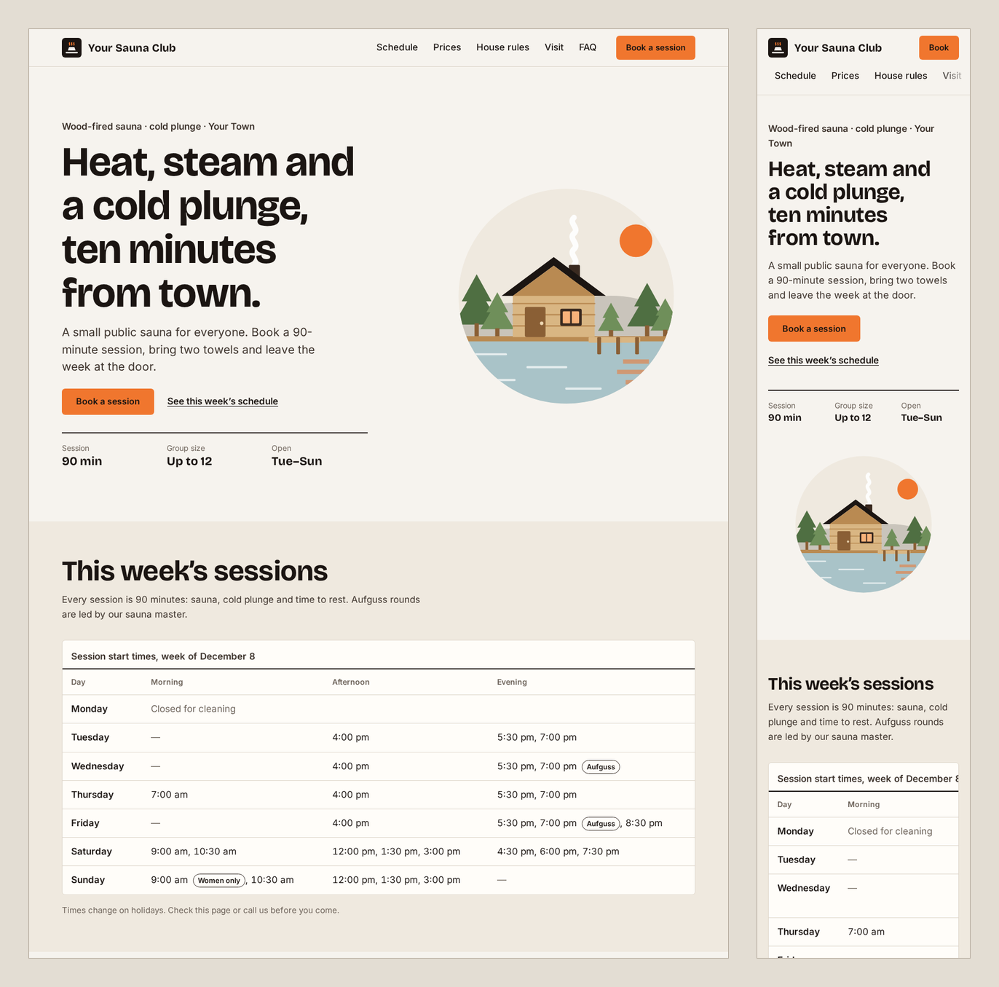

# Free sauna spreadsheet, Notion and design templates

Twelve free templates for people who build, own or run a sauna. Templates 1 to 5: four are spreadsheets that open in Excel, Google Sheets,
Numbers and LibreOffice; one is a Notion page with its import files. Each of those folders has the template, a CSV, a `preview.png`,
a `README.md` and a `LISTING.md` with ready-to-paste title, descriptions, tags and license. Free to use and share under CC BY 4.0.

Made by DIVELUX, makers of wool sauna hats: https://diveluxsaunahat.com ·
more free tools: https://diveluxsaunahat.com/pages/sauna-tools

| # | Template | Preview | Format | Files |
|---|---|---|---|---|
| 1 | [Home Sauna Build Budget](home-sauna-build-budget/) |  | Spreadsheet (.xlsx) + CSV | [`home-sauna-build-budget.xlsx`](home-sauna-build-budget/home-sauna-build-budget.xlsx) [`home-sauna-build-budget-example.xlsx`](home-sauna-build-budget/home-sauna-build-budget-example.xlsx) [`home-sauna-build-budget.csv`](home-sauna-build-budget/home-sauna-build-budget.csv) |
| 2 | [Sauna Heater Sizing Sheet](sauna-heater-sizing-sheet/) |  | Spreadsheet (.xlsx) + CSV | [`sauna-heater-sizing-sheet.xlsx`](sauna-heater-sizing-sheet/sauna-heater-sizing-sheet.xlsx) [`sauna-heater-sizing-sheet-examples.csv`](sauna-heater-sizing-sheet/sauna-heater-sizing-sheet-examples.csv) |
| 3 | [Sauna Cleaning Rota for gyms and spas](sauna-cleaning-rota/) |  | Spreadsheet (.xlsx) + CSV | [`sauna-cleaning-rota.xlsx`](sauna-cleaning-rota/sauna-cleaning-rota.xlsx) [`sauna-cleaning-rota-example.xlsx`](sauna-cleaning-rota/sauna-cleaning-rota-example.xlsx) [`sauna-cleaning-rota-tasks.csv`](sauna-cleaning-rota/sauna-cleaning-rota-tasks.csv) |
| 4 | [Sauna Booking Log for clubs](sauna-booking-log/) |  | Spreadsheet (.xlsx) + CSV | [`sauna-booking-log.xlsx`](sauna-booking-log/sauna-booking-log.xlsx) [`sauna-booking-log-example.xlsx`](sauna-booking-log/sauna-booking-log-example.xlsx) [`sauna-booking-log.csv`](sauna-booking-log/sauna-booking-log.csv) |
| 5 | [Notion: Home sauna: upkeep and costs](notion-home-sauna-upkeep-costs/) |  | Notion build notes (.md) + 2 CSV | [`notion-template.md`](notion-home-sauna-upkeep-costs/notion-template.md) [`upkeep-tasks.csv`](notion-home-sauna-upkeep-costs/upkeep-tasks.csv) [`costs.csv`](notion-home-sauna-upkeep-costs/costs.csv) |

## Design templates for sauna clubs and spas

Seven design templates: a menu, social stories, an Aufguss board, a membership card, event posters, a booking app UI kit and a one-page website. The print and social templates come as a self-contained HTML file you can edit in the browser (click any text, then print or save as PDF), ready-made PDFs or PNGs with sample text, and SVG files with live text for Figma. Sample names, prices and dates are placeholders. Each folder has its own README with editing and printing notes. The website template is MIT-licensed; the others are CC BY 4.0.

| # | Template | Preview | Format | Files |
|---|---|---|---|---|
| 6 | [Spa and Sauna Menu and Price List](spa-menu-price-list/) |  | Editable HTML + PDF (Letter, A4) + PNG 1080 × 1350 + Figma SVG | [`spa-menu-price-list.html`](spa-menu-price-list/spa-menu-price-list.html) [`spa-menu-price-list-letter.pdf`](spa-menu-price-list/spa-menu-price-list-letter.pdf) [`spa-menu-price-list-a4.pdf`](spa-menu-price-list/spa-menu-price-list-a4.pdf) [`spa-menu-price-list-post.png`](spa-menu-price-list/spa-menu-price-list-post.png) [`spa-menu-price-list-letter.svg`](spa-menu-price-list/spa-menu-price-list-letter.svg) [`spa-menu-price-list-a4.svg`](spa-menu-price-list/spa-menu-price-list-a4.svg) [`spa-menu-price-list-post.svg`](spa-menu-price-list/spa-menu-price-list-post.svg) |
| 7 | [Sauna Club Social Stories](sauna-club-social-stories/) |  | 8 stories, 1080 × 1920: SVG + PNG + editable HTML | [`sauna-club-stories.html`](sauna-club-social-stories/sauna-club-stories.html) [`svg/`](sauna-club-social-stories/svg/) [`png/`](sauna-club-social-stories/png/) |
| 8 | [Aufguss Schedule Board](aufguss-schedule-board/) |  | Editable HTML + PDF (A3, Tabloid) + 1920 × 1080 TV screen + Figma SVG | [`aufguss-schedule-board.html`](aufguss-schedule-board/aufguss-schedule-board.html) [`aufguss-schedule-board-a3.pdf`](aufguss-schedule-board/aufguss-schedule-board-a3.pdf) [`aufguss-schedule-board-tabloid.pdf`](aufguss-schedule-board/aufguss-schedule-board-tabloid.pdf) [`aufguss-schedule-board-tv.png`](aufguss-schedule-board/aufguss-schedule-board-tv.png) [`aufguss-schedule-board-a3.svg`](aufguss-schedule-board/aufguss-schedule-board-a3.svg) [`aufguss-schedule-board-tabloid.svg`](aufguss-schedule-board/aufguss-schedule-board-tabloid.svg) [`aufguss-schedule-board-tv.svg`](aufguss-schedule-board/aufguss-schedule-board-tv.svg) |
| 9 | [Sauna Club Membership Card](sauna-club-membership-card/) |  | Editable HTML + PDF (CR80 with bleed, 10-up A4 and Letter) + Figma SVG | [`sauna-club-membership-card.html`](sauna-club-membership-card/sauna-club-membership-card.html) [`sauna-club-membership-card-cr80.pdf`](sauna-club-membership-card/sauna-club-membership-card-cr80.pdf) [`sauna-club-membership-card-a4.pdf`](sauna-club-membership-card/sauna-club-membership-card-a4.pdf) [`sauna-club-membership-card-letter.pdf`](sauna-club-membership-card/sauna-club-membership-card-letter.pdf) [`sauna-club-membership-card-cr80-front.svg`](sauna-club-membership-card/sauna-club-membership-card-cr80-front.svg) [`sauna-club-membership-card-cr80-back.svg`](sauna-club-membership-card/sauna-club-membership-card-cr80-back.svg) |
| 10 | [Sauna Event Poster (3 layouts)](sauna-event-poster/) |  | Editable HTML + PDF (Letter, A3) + PNG 1080 × 1350 + Figma SVG | [`sauna-event-poster.html`](sauna-event-poster/sauna-event-poster.html) [`sauna-event-poster-aufguss-letter.pdf`](sauna-event-poster/sauna-event-poster-aufguss-letter.pdf) [`sauna-event-poster-aufguss-a3.pdf`](sauna-event-poster/sauna-event-poster-aufguss-a3.pdf) [`sauna-event-poster-social-letter.pdf`](sauna-event-poster/sauna-event-poster-social-letter.pdf) [`sauna-event-poster-social-a3.pdf`](sauna-event-poster/sauna-event-poster-social-a3.pdf) [`sauna-event-poster-open-letter.pdf`](sauna-event-poster/sauna-event-poster-open-letter.pdf) [`sauna-event-poster-open-a3.pdf`](sauna-event-poster/sauna-event-poster-open-a3.pdf) [`sauna-event-poster-aufguss-post.png`](sauna-event-poster/sauna-event-poster-aufguss-post.png) [`sauna-event-poster-social-post.png`](sauna-event-poster/sauna-event-poster-social-post.png) [`sauna-event-poster-open-post.png`](sauna-event-poster/sauna-event-poster-open-post.png) |
| 11 | [Sauna Booking App UI Kit](sauna-booking-app-ui-kit/) |  | 6 screens (390 × 844) + components: SVG + PNG + tokens.json | [`sauna-booking-ui-kit-sheet.svg`](sauna-booking-app-ui-kit/sauna-booking-ui-kit-sheet.svg) [`screens/`](sauna-booking-app-ui-kit/screens/) [`png/`](sauna-booking-app-ui-kit/png/) [`tokens.json`](sauna-booking-app-ui-kit/tokens.json) |
| 12 | [Sauna Club Website template](sauna-club-website/) |  | One-page HTML + CSS, no dependencies (MIT) | [`index.html`](sauna-club-website/index.html) [`styles.css`](sauna-club-website/styles.css) [`assets/`](sauna-club-website/assets/) [`fonts/`](sauna-club-website/fonts/) [`LICENSE`](sauna-club-website/LICENSE) |

## Using the spreadsheets

- White cells are for typing. Gray cells calculate themselves; leave them alone.
- Each workbook has a "How to use" sheet. Files ending in `-example.xlsx` show the template filled in with sample data (made-up names and numbers).
- Google Sheets: upload the `.xlsx` to Google Drive, open it, then File → Save as Google Sheets. Check the drop-downs once after the conversion (and the chart in the budget file).
- The fonts named in the files are Bricolage Grotesque and Inter (SIL Open Font License 1.1). Without them installed, your spreadsheet program picks a default font and everything still works.
- Every sheet is set up to print on US Letter.

## License

CC BY 4.0 (Creative Commons Attribution 4.0 International). Credit: DIVELUX, https://diveluxsaunahat.com
The DIVELUX name and logo are © DIVELUX Inc. and are not covered by the license.

Every sheet carries the credit line "Made by DIVELUX, makers of wool sauna hats — diveluxsaunahat.com" with a link. Please keep it when you share or adapt the files.

## Rebuilding

Sources live in `_build/`. `python3 _build/build_templates.py` writes the workbooks and CSVs with openpyxl, recalculates every
workbook with the Python package `formulas` and fails on any Excel error value, compares the key totals with an independent
calculation (the heater sheet also against `heater.js` of the online calculator and the manufacturers' worked examples), and draws
the previews with Playwright (one Chromium at a time, under `flock /tmp/freebies-chromium.lock`). `--no-preview` skips the images.
`python3 _build/listings.py` rewrites the LISTING.md and README.md files and checks the length limits.

The previews are renderings of the real workbook cells, not screenshots of Excel. The Notion preview is a layout mockup.

General information: not professional, electrical or medical advice. Electrical work is for a licensed electrician; for heaters,
follow the manufacturer's manual.

Templates 6 to 12 are built by separate scripts in `_build/`: `python3 _build/w3_build.py` and `python3 _build/w3_listings.py` (menu, Aufguss board, membership card, posters; Chromium under the same lock), and `t65_stories.py`, `t69_uikit.py`, `t70_site.py` followed by `w3s_listings.py` (stories, UI kit, website). Their README rows above are kept by hand.
