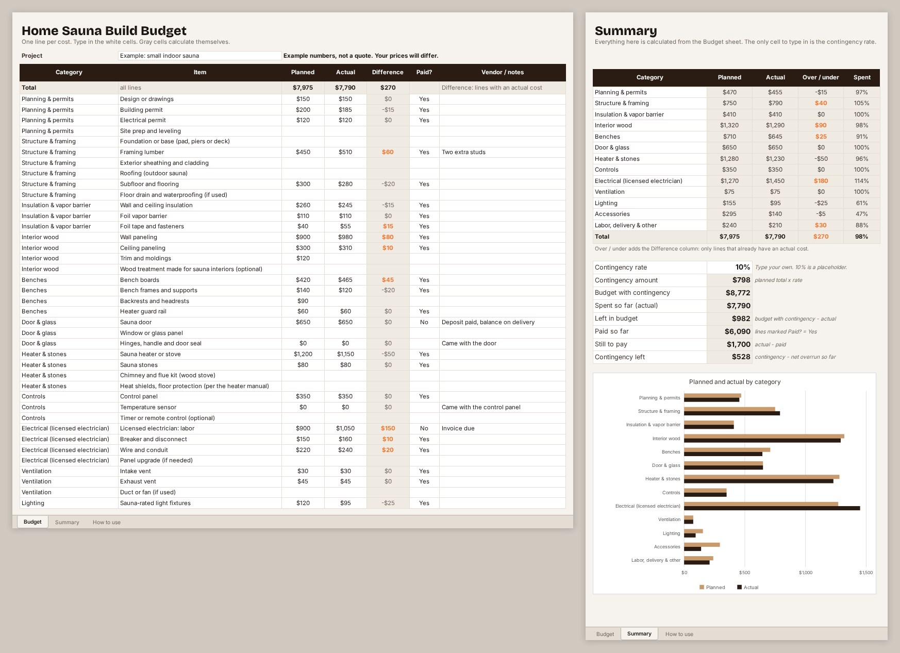

# Home Sauna Build Budget Spreadsheet

Free budget spreadsheet for building a home sauna: 50 cost lines in 13 categories, planned vs actual, contingency, paid and owed, and a chart.

Made by [DIVELUX](https://diveluxsaunahat.com), makers of handmade wool sauna hats. More free sauna tools: https://diveluxsaunahat.com/pages/sauna-tools

## Files

| File | What it is |
|---|---|
| [`home-sauna-build-budget.xlsx`](home-sauna-build-budget.xlsx) | the empty template: Budget, Summary (with chart), How to use |
| [`home-sauna-build-budget-example.xlsx`](home-sauna-build-budget-example.xlsx) | the same file filled in with sample numbers (not a quote) |
| [`home-sauna-build-budget.csv`](home-sauna-build-budget.csv) | the 50 cost lines with their categories, for Notion, Airtable or your own sheet |
| [`preview.png`](preview.png) | rendering of the example file: Budget and Summary sheets |

## How to use

1. Open `home-sauna-build-budget.xlsx`. On the **Budget** sheet every line is one cost. Reword lines, clear the ones you do not need, add your own in the empty rows. Pick the category from the drop-down.
2. Type what you expect to pay in **Planned**. When you buy or get an invoice, type the amount in **Actual** and set **Paid?** to Yes once it is paid.
3. Open **Summary** for totals by category, the contingency cushion, what is left, what is still owed, and the chart. The only cell to type in there is the contingency rate (10% is a placeholder).

`home-sauna-build-budget-example.xlsx` shows the file at work. Its numbers are round samples for a small indoor sauna. They are not prices and not a quote.

## Sheets and formulas

| Sheet | What it does |
|---|---|
| Budget | 70 rows: Category, Item, Planned, Actual, Difference, Paid?, Vendor / notes. `Difference = Actual - Planned`, shown only when Actual has a number; lines over plan turn orange. A total row under the header. |
| Summary | Planned, Actual and Over / under for each of the 13 categories (`SUMIF` on the Budget sheet), share spent, contingency amount (`planned total x rate`), budget with contingency, left in budget, paid so far, still to pay, contingency left. A bar chart of planned against actual. |
| How to use | The steps above, inside the file. |

The formulas were recalculated outside Excel with the Python package `formulas` and compared with an independent calculation; see `../_build/build_templates.py`.

## Good to know

- The file gives no price guidance. Prices depend on your region, the room and the materials: get real quotes.
- Electrical work: a licensed electrician and the permit your city requires. Heater, clearances and wiring: follow the manufacturer's manual.
- For a first idea of heater size, see the [Sauna Heater Sizing Sheet](../sauna-heater-sizing-sheet/) or the [online calculator](https://divelux.github.io/sauna-heater-calculator/).
- Other currencies: select the money columns and change the number format.

## License

[CC BY 4.0](https://creativecommons.org/licenses/by/4.0/). Free to use, share and adapt. Credit DIVELUX with a link to https://diveluxsaunahat.com.
The DIVELUX name and logo are © DIVELUX Inc. and are not covered by the license.
