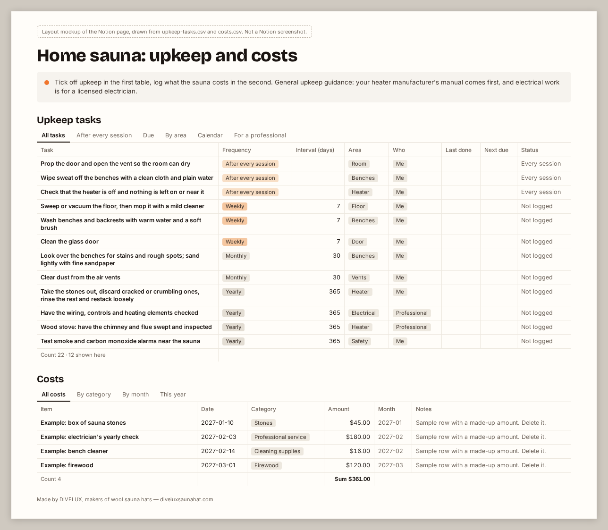

# Home sauna: upkeep and costs (Notion template)

Free Notion template for home sauna owners: an upkeep task list with next-due dates and a cost log with totals by category and month. CSVs included.

Made by [DIVELUX](https://diveluxsaunahat.com), makers of handmade wool sauna hats. More free sauna tools: https://diveluxsaunahat.com/pages/sauna-tools

## Files

| File | What it is |
|---|---|
| [`notion-template.md`](notion-template.md) | how to build the page: properties, formulas, views, texts |
| [`upkeep-tasks.csv`](upkeep-tasks.csv) | 22 upkeep tasks with frequency, interval in days, area and notes |
| [`costs.csv`](costs.csv) | the cost log columns with four sample rows (made-up amounts; delete them) |
| [`preview.png`](preview.png) | layout mockup of the page, drawn from the two CSVs; not a Notion screenshot |

## What is here

Nothing in this folder is a published Notion page yet. It holds everything needed to build one in about ten minutes:

1. Follow `notion-template.md`: create the page and two databases, **Upkeep tasks** and **Costs**.
2. Import `upkeep-tasks.csv` and `costs.csv` with *Merge with CSV*, then set the property types and paste the formulas from the notes.
3. Add the views, delete the `Example:` cost rows, publish with "Allow duplicate as template" and submit the link.

`preview.png` is a layout mockup drawn from the two CSVs in our own style. It is not a screenshot of Notion; replace it with a real screenshot once the page exists.

## Structure

| Database | Properties | Views |
|---|---|---|
| Upkeep tasks | Task, Frequency, Interval (days), Area, Who, Last done, Next due (formula), Status (formula), Notes | All tasks, After every session, Due, By area, Calendar, For a professional |
| Costs | Item, Date, Category, Amount, Vendor, Task (relation, optional), Month (formula), Year (formula), Notes | All costs, By category, By month, This year |

Formulas: `Next due = dateAdd(Last done, Interval (days), "days")`; `Status` is "Every session", "Not logged", "Due" or "OK"; `Month = formatDate(Date, "YYYY-MM")`. They are written for Notion's current formula syntax and have not been run in a live workspace from here: test them once after pasting.

## Good to know

- The 22 tasks are the generally accepted home-sauna routine, the same list as the printable [Sauna Care and Cleaning Schedule](../../printables/sauna-care-cleaning-schedule/). Saunas, heaters and local codes differ: follow the manufacturer's manual for your heater, and leave electrical work to a licensed electrician.
- The amounts in `costs.csv` are made-up sample numbers, not prices.
- Prefer a spreadsheet? The CSVs open in Excel and Google Sheets as they are.

## License

[CC BY 4.0](https://creativecommons.org/licenses/by/4.0/). Free to use, share and adapt. Credit DIVELUX with a link to https://diveluxsaunahat.com.
The DIVELUX name and logo are © DIVELUX Inc. and are not covered by the license.
