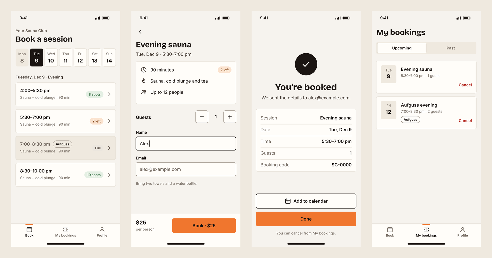

# Sauna Booking App UI Kit

Six phone screens (390 × 844), a component board and design tokens for a sauna or bathhouse booking app.
Made by DIVELUX, makers of wool sauna hats — https://diveluxsaunahat.com · more free tools: https://diveluxsaunahat.com/pages/sauna-tools

## What is inside

| File | What it is |
|---|---|
| `sauna-booking-ui-kit-sheet.svg` | Everything on one board: the six screens, buttons, badges, day chips, slot cards, inputs, stepper, toggles, segmented control, tab bar, color and type specimens |
| `screens/01-slots.svg` … `06-empty.svg` | One SVG per screen, 390 × 844 |
| `png/` | The screens at 2x (780 × 1688) and `sheet.png` |
| `tokens.json` | Colors, type styles, radii, spacing and sizes in the W3C design tokens format (`$value` / `$type`) |

Screens: 01 slots by day · 02 book a slot · 03 booking confirmed · 04 my bookings · 05 profile and membership · 06 empty state.

## Import into Figma

1. Install the fonts if you work offline: Bricolage Grotesque and Inter (both on Google Fonts; Figma in the browser has them already).
2. Drag `sauna-booking-ui-kit-sheet.svg` or the files in `screens/` onto the canvas. Each SVG becomes a frame; group names
   (`tab-bar`, `slot-2`, `book-button`, `field-email` …) become layer names, and the text stays editable.
3. To reuse a piece, select its group and choose *Create component*. The shapes are plain vectors, not auto layout, so add auto
   layout where you want it.
4. Tokens: open the Tokens Studio for Figma plugin, choose the W3C DTCG format and load `tokens.json`, or copy the values by hand.

Penpot and Illustrator import the same SVG files.

## Accessibility notes

Text and background pairs used in the kit, checked with the WCAG 2 formula:

| Text | Background | Ratio |
|---|---|---|
| ink `#1b1512` | bg `#f6f3ee` | 16.3:1 |
| ink `#1b1512` | surface `#fffdf9` | 17.8:1 |
| ink-2 `#3d332c` | surface `#fffdf9` | 12.1:1 |
| muted `#6f655c` | bg `#f6f3ee` | 5.1:1 |
| muted `#6f655c` | surface `#fffdf9` | 5.6:1 |
| muted `#6f655c` | surface-2 `#efe9df` | 4.7:1 |
| on-accent `#1b1512` | accent `#f0762e` | 6.3:1 |
| on-inverse `#f6f3ee` | inverse `#1b1512` | 16.3:1 |
| success `#2f6b3f` | success-bg `#e4efe3` | 5.4:1 |
| warning `#7a3a0c` | warning-bg `#fbe3cf` | 7.0:1 |
| neutral `#5c534b` | neutral-bg `#ebe6de` | 6.1:1 |
| danger `#b3261e` | surface `#fffdf9` | 6.4:1 |
| ink `#1b1512` | surface-2 `#efe9df` | 15.0:1 |

Input borders and other UI edges are at least 3:1. Tap targets (buttons, tabs, chips, stepper, cancel links) are at least 44 × 44 px.
Disabled controls are not required to meet contrast, but the disabled color here still reads.

## Sample data

Club name, person, dates, times, prices and the booking code are placeholders. Replace them with your own.

## Rebuilding

`python3 ../_build/t69_uikit.py` rebuilds everything (needs `resvg-py` and `fontTools`) and stops if a contrast pair fails.

## License

CC BY 4.0. Credit line: "UI kit by DIVELUX — diveluxsaunahat.com". The empty-state drawing is from DIVELUX Sauna Illustrations (CC BY 4.0).
The DIVELUX name and logo are not covered by the license.
