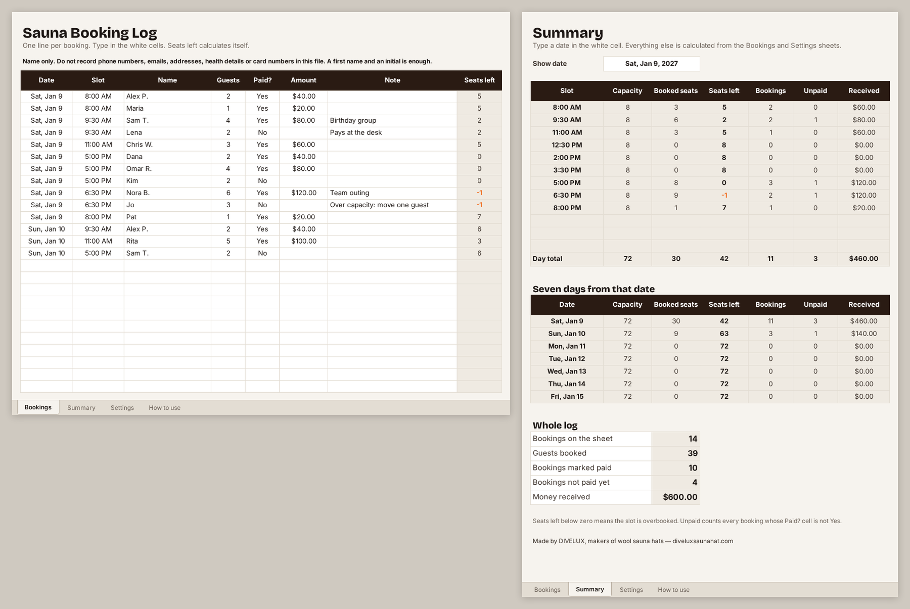

# Sauna Booking Log for Clubs

Free booking log for a sauna club: date, slot, name, guests, paid yes/no. Shows seats left, flags overbooked slots and sums each day. Names only.

Made by [DIVELUX](https://diveluxsaunahat.com), makers of handmade wool sauna hats. More free sauna tools: https://diveluxsaunahat.com/pages/sauna-tools

## Files

| File | What it is |
|---|---|
| [`sauna-booking-log.xlsx`](sauna-booking-log.xlsx) | the empty template: Bookings, Summary, Settings, How to use |
| [`sauna-booking-log-example.xlsx`](sauna-booking-log-example.xlsx) | the same file with 14 made-up bookings over two days, one slot overbooked on purpose |
| [`sauna-booking-log.csv`](sauna-booking-log.csv) | the column headings and two example rows, for another system |
| [`preview.png`](preview.png) | rendering of the example file: Bookings and Summary sheets |

## How to use

1. **Settings** sheet: type your session times in the *Slot* column and the number of seats for each. Up to 12 slots. The times and the capacity of 8 in the file are placeholders.
2. **Bookings** sheet: one line per booking. Type the date, pick the slot from the drop-down, type a name and the number of guests. Set *Paid?* to Yes when it is paid and type the amount.
3. *Seats left* shows the free seats in that date and slot after every booking on the sheet is counted. Below zero it turns orange: the slot is overbooked.
4. **Summary** sheet: type a date in the white cell to see that day slot by slot and the seven days that start there.

`sauna-booking-log-example.xlsx` shows the file at work. The names and amounts are made up.

## Personal data

The log is meant to hold a name and nothing else about a person. Do not record phone numbers, emails, addresses, health details or card numbers in it; a first name and an initial is enough. If you need contact details, keep them in the system your club already uses for member data.

## Sheets and formulas

| Sheet | What it does |
|---|---|
| Bookings | 200 rows: Date, Slot, Name, Guests, Paid?, Amount, Note, Seats left. `Seats left = capacity of the slot - guests booked for the same date and slot`. |
| Summary | For the chosen date, per slot: Capacity, Booked seats, Seats left, Bookings, Unpaid, Received, and a day total. The same figures per day for seven days. Totals of the whole log. |
| Settings | Club name, 12 slot names with their capacity. Feeds the drop-down and the Summary. |
| How to use | The steps above, inside the file. |

The counting formulas use `SUMPRODUCT` with plain `=` tests on date and slot instead of `SUMIFS`, so a slot name such as `8:00 AM` is matched exactly as written and is never re-read as a time. An empty *Paid?* cell counts as unpaid.

The formulas were recalculated outside Excel with the Python package `formulas` and compared with an independent calculation; see `../_build/build_templates.py`.

## Good to know

- A cancelled booking: delete the line, or set Guests to 0 and write the reason in Note.
- A new month or season: save a copy of the file and clear the white cells on the Bookings sheet.
- Other currencies: select the Amount cells and change the number format.

## License

[CC BY 4.0](https://creativecommons.org/licenses/by/4.0/). Free to use, share and adapt. Credit DIVELUX with a link to https://diveluxsaunahat.com.
The DIVELUX name and logo are © DIVELUX Inc. and are not covered by the license.
