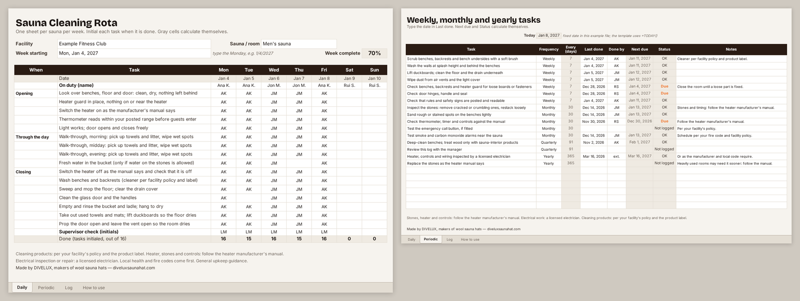

# Sauna Cleaning Rota for Gyms and Spas

Free cleaning rota for a gym, spa or club sauna: daily tasks by day with initials, weekly to yearly tasks with next-due dates, and a maintenance log.

Made by [DIVELUX](https://diveluxsaunahat.com), makers of handmade wool sauna hats. More free sauna tools: https://diveluxsaunahat.com/pages/sauna-tools

## Files

| File | What it is |
|---|---|
| [`sauna-cleaning-rota.xlsx`](sauna-cleaning-rota.xlsx) | the empty template: Daily, Periodic, Log, How to use |
| [`sauna-cleaning-rota-example.xlsx`](sauna-cleaning-rota-example.xlsx) | the same file with one sample week and sample dates (made-up names) |
| [`sauna-cleaning-rota-tasks.csv`](sauna-cleaning-rota-tasks.csv) | all 32 tasks with frequency, for another system |
| [`preview.png`](preview.png) | rendering of the example file: Daily and Periodic sheets |

## How to use

1. **Daily** sheet: one copy per sauna per week. Type the facility, the room and the Monday the week starts on; the dates fill in. Put the name of the person on duty under each day.
2. When a task is done, the person who did it types their initials in that day's cell, or writes them by hand on a printed copy. The sheet prints on one landscape US Letter page for a clipboard by the door.
3. **Periodic** sheet: type the date in *Last done* and the initials. *Next due* and *Status* calculate themselves from today's date.
4. **Log** sheet: one line for anything worth a record. Print it and sign in the last column if your facility needs a signature.

`sauna-cleaning-rota-example.xlsx` shows a filled-in week. The names are made up, and its "Today" cell holds a fixed date so the example always looks the same.

## Sheets and formulas

| Sheet | What it does |
|---|---|
| Daily | 16 tasks in three groups (Opening, Through the day, Closing) by 7 days. Dates = week start + 0…6. *Done* = `COUNTA` of the initialed cells for each day; *Week complete* = all initialed cells / 112. |
| Periodic | 16 tasks plus 6 empty rows. *Every (days)*: Weekly 7, Monthly 30, Quarterly 91, Yearly 365. *Next due* = Last done + Every. *Status*: "Not logged" with no date, "Due" when Next due is before today (`TODAY()`), otherwise "OK". "Due" shows in orange. |
| Log | Date, Time, Area (drop-down), What was done, Done by, Checked by (signature), Notes. 40 rows. |
| How to use | The steps above, inside the file. |

The formulas were recalculated outside Excel with the Python package `formulas` and compared with an independent calculation; see `../_build/build_templates.py`.

## Good to know

- The task lists are a starting point built from general upkeep practice. Rewrite them to match your rooms and your health department's rules, which come first.
- Cleaning products and dilution: per your facility's policy and the product label. Avoid harsh chemicals on bare wood.
- Heater, stones and controls: follow the heater manufacturer's manual. Electrical inspection and repair: a licensed electrician.
- For a home sauna, see the printable [Sauna Care and Cleaning Schedule](../../printables/sauna-care-cleaning-schedule/).

## License

[CC BY 4.0](https://creativecommons.org/licenses/by/4.0/). Free to use, share and adapt. Credit DIVELUX with a link to https://diveluxsaunahat.com.
The DIVELUX name and logo are © DIVELUX Inc. and are not covered by the license.
