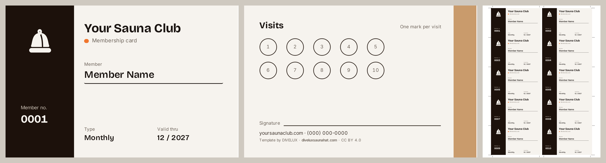

# Sauna Club Membership Card

Free editable membership card for a sauna club: credit-card size with bleed, a 10-visit punch grid on the back, and 10-up print sheets for A4 and US Letter.

## Files

- `sauna-club-membership-card.html`
- `sauna-club-membership-card-cr80.pdf`
- `sauna-club-membership-card-a4.pdf`
- `sauna-club-membership-card-letter.pdf`
- `sauna-club-membership-card-cr80-front.png`
- `sauna-club-membership-card-cr80-back.png`
- `sauna-club-membership-card-cr80-front.svg`
- `sauna-club-membership-card-cr80-back.svg`
- `sauna-club-membership-card-a4-sheet-front.svg`
- `sauna-club-membership-card-a4-sheet-back.svg`
- `sauna-club-membership-card-letter-sheet-front.svg`
- `sauna-club-membership-card-letter-sheet-back.svg`
- `preview.png`
- `LICENSE`

## Edit in your browser

1. Open `sauna-club-membership-card.html` in Chrome, Edge, Firefox or Safari. Nothing is loaded from the internet: the fonts are inside the file.
2. Click any text and type. Club name, card title, type, valid-thru, punch-grid text and contact line are shared by all cards; member name and number are per card.
3. Pick the size in the dark bar at the top, then **Print / Save PDF**. In the print dialog: scale 100% (actual size),
   margins None, background graphics on.
4. Your edits are saved in this browser only (local storage), never uploaded. **Reset** brings back the sample text.
   To keep or share a finished version, save it as a PDF.

Sizes: `?size=card` (default: one card with bleed, front and back), `?size=a4` and `?size=letter` (ten per sheet). You can also add the size to the address by hand, for example `sauna-club-membership-card.html?size=card`.

## Printing

- **Print shop:** send `sauna-club-membership-card-cr80.pdf`. Page 1 is the front, page 2 the back, each 91.6 × 60 mm:
  the 85.6 × 54 mm card (CR80, the credit-card size of ISO/IEC 7810 ID-1) plus 3 mm bleed on every side.
  Keep your own text at least 3 mm inside the trim line.
- **At home:** print the sheet PDF on card stock at 100%. Page 1 is the front sheet, page 2 the back sheet: print two-sided,
  flip on the long edge. Print a test on plain paper first and hold it against a window to check that front and back line up.
- Cut along the marks. The rows touch each other, so one straight cut separates two rows. On US Letter the marks above and
  below the cards sit only about 5 mm from the edge; if your printer clips them, use the side marks.
- To punch the circles use a small hole punch, a pen or a stamp.

## Figma and other design apps

Every size also comes as a plain SVG made from the same layout:

1. In Figma, drag the `.svg` file onto the canvas (or File → Import). Illustrator, Inkscape, Affinity and Penpot open it too.
2. Text stays live text in **Bricolage Grotesque** and **Inter**. Both are free Google Fonts and are built into Figma;
   for desktop apps, install them from fonts.google.com.
3. Layers are grouped and named after the fields (`club-name`, `date`, `item-price` …). Each line of a paragraph is its own
   text layer, so rewrap long paragraphs by hand or join the lines into one text box.
4. Sizes are in pixels at 96 per inch (the CSS pixel), so a US Letter page is 816 × 1056.

## Sample text

Every name, date, time and price in the files is a placeholder ("Your Sauna Club", "$00", "Name"). Replace them before you print.
Health notes are kept general; check any wording you add with your own rules and local requirements.

## Credits and license

Template by DIVELUX, makers of wool sauna hats: https://diveluxsaunahat.com · more free tools: https://diveluxsaunahat.com/pages/sauna-tools

CC BY 4.0 (Creative Commons Attribution 4.0 International). Credit: DIVELUX, https://diveluxsaunahat.com
The DIVELUX name and logo are © DIVELUX Inc. and are not covered by the license. Fonts: Bricolage Grotesque and Inter (SIL Open Font License 1.1).
The hat icon comes from the DIVELUX Sauna Icons (filled) set (CC BY 4.0).

You may use, change and print these templates for your business, including for commercial use. Please keep the small
credit line ("Template by DIVELUX · diveluxsaunahat.com · CC BY 4.0") or credit DIVELUX somewhere reasonable, such as your website.

## Rebuilding

The files are built by `templates/_build/w3_build.py` (writes the HTML, renders PDFs, PNGs and SVGs with one headless Chromium,
compares every SVG with the page pixel by pixel and runs an editing test) and `templates/_build/w3_listings.py` (this README and LISTING.md).
