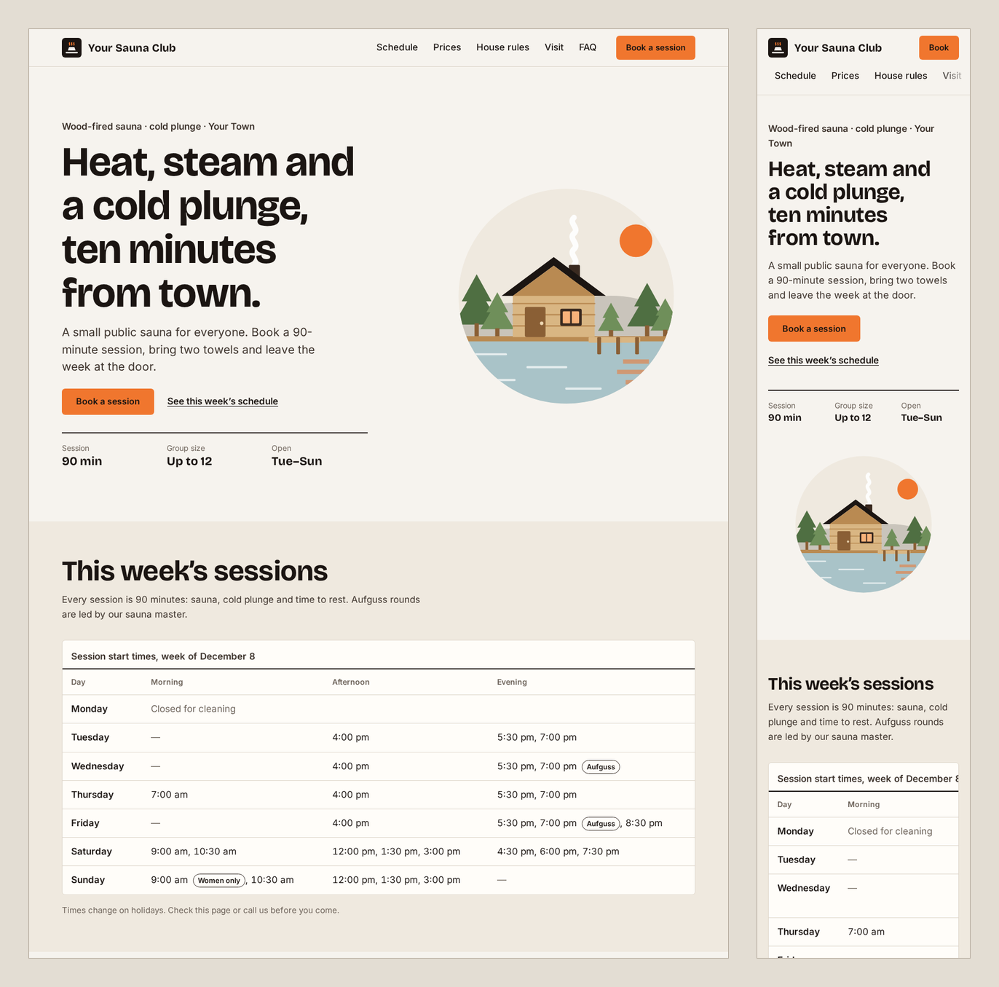

# Sauna Club Website Template

A one-page website for a sauna club, bathhouse or small public sauna. Plain HTML and CSS: no framework, no build step,
no JavaScript and no requests to other servers.
Made by DIVELUX, makers of wool sauna hats — https://diveluxsaunahat.com · more free tools: https://diveluxsaunahat.com/pages/sauna-tools



## Files

```
index.html       the page
styles.css       all styles; colors, fonts and widths are variables in :root at the top
assets/          mark.svg (logo placeholder), favicon.svg, lakeside-sauna.svg (illustration)
fonts/           Bricolage Grotesque and Inter, Latin subset, woff2 + OFL.txt
```

## Make it yours

1. Open `index.html` in a text editor. Every name, address, phone number, time and price is sample text: search for
   "Your Sauna Club", "Your Town", "123 Example Road", "555", "example.com" and "$" and replace them.
2. Booking: the Book buttons point to the Visit section. If you use a booking service, put its link in the two `href="#visit"`
   buttons.
3. Map: replace the dashed "Map goes here" box with a map image and a link to your map listing.
4. Colors: change the variables at the top of `styles.css`. Keep `--accent` for the main button only and check that text on it
   stays readable (dark text on the default orange is 6.3:1).
5. Logo: replace `assets/mark.svg` and `assets/favicon.svg`.
6. Upload the folder to any static host (GitHub Pages, Netlify, Cloudflare Pages, your own server).

The health note under the house rules is general guidance. Keep a note like it, and follow your local rules for public saunas.

## What we checked

- Widths 375, 390, 768 and 1280 px in Chromium: no sideways scrolling (the schedule table scrolls inside its own box on phones)
- One `h1`, headings in order, `header` / `nav` / `main` / `footer` landmarks, `lang="en-US"`
- Skip link is the first thing you reach with Tab; focus is always visible
- Images have alt text; links and buttons are at least 44 px tall
- Text contrast at least 4.5:1 everywhere (most pairs 10:1 or more)
- `prefers-reduced-motion` turns off smooth scrolling and transitions
- No console errors, no outside requests

## Credit

The footer says "Website template by DIVELUX". The MIT License lets you remove it. If you keep it, thank you.

## License

Code (HTML, CSS): MIT License, see `LICENSE`. `assets/lakeside-sauna.svg` comes from DIVELUX Sauna Illustrations (CC BY 4.0).
Fonts: SIL Open Font License 1.1 (`fonts/OFL.txt`). The DIVELUX name is not covered by any of these licenses.
