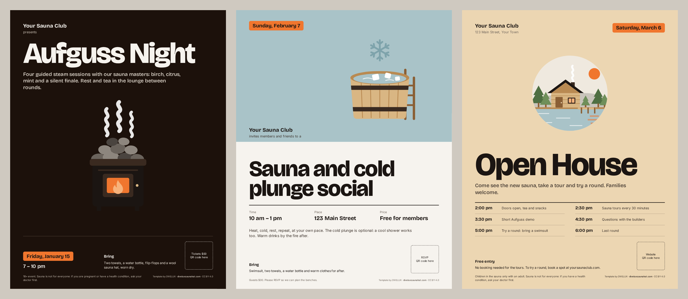

# Sauna Event Poster

Free editable sauna event posters: Aufguss night, sauna and cold plunge social, open house. US Letter and A3 to print, 1080 x 1350 posts, Figma-ready SVG.

## Files

- `sauna-event-poster.html`
- `sauna-event-poster-aufguss-letter.pdf`
- `sauna-event-poster-aufguss-a3.pdf`
- `sauna-event-poster-aufguss-post.png`
- `sauna-event-poster-aufguss-letter.svg`
- `sauna-event-poster-aufguss-a3.svg`
- `sauna-event-poster-aufguss-post.svg`
- `sauna-event-poster-social-letter.pdf`
- `sauna-event-poster-social-a3.pdf`
- `sauna-event-poster-social-post.png`
- `sauna-event-poster-social-letter.svg`
- `sauna-event-poster-social-a3.svg`
- `sauna-event-poster-social-post.svg`
- `sauna-event-poster-open-letter.pdf`
- `sauna-event-poster-open-a3.pdf`
- `sauna-event-poster-open-post.png`
- `sauna-event-poster-open-letter.svg`
- `sauna-event-poster-open-a3.svg`
- `sauna-event-poster-open-post.svg`
- `preview.png`
- `LICENSE`

## Edit in your browser

1. Open `sauna-event-poster.html` in Chrome, Edge, Firefox or Safari. Nothing is loaded from the internet: the fonts are inside the file.
2. Click any text and type. Choose the layout and the size in the top bar. The club name is shared by the three layouts; in the open house timetable, hover a line to remove it or use **+ Add line**.
3. Pick the size in the dark bar at the top, then **Print / Save PDF**. In the print dialog: scale 100% (actual size),
   margins None, background graphics on.
4. Your edits are saved in this browser only (local storage), never uploaded. **Reset** brings back the sample text.
   To keep or share a finished version, save it as a PDF.

Sizes: `?size=letter` (default), `?size=a3`, `?size=post` (1080 × 1350 px); layouts `?layout=aufguss`, `?layout=social`, `?layout=open`. You can also add the size to the address by hand, for example `sauna-event-poster.html?size=letter`.

## Printing

Letter prints on any office printer; A3 on large-format printers or at a copy shop. Replace the dashed QR box with your own code: print the poster, then stick the code on, or swap the box for the code in the SVG.

## Figma and other design apps

Every size also comes as a plain SVG made from the same layout:

1. In Figma, drag the `.svg` file onto the canvas (or File → Import). Illustrator, Inkscape, Affinity and Penpot open it too.
2. Text stays live text in **Bricolage Grotesque** and **Inter**. Both are free Google Fonts and are built into Figma;
   for desktop apps, install them from fonts.google.com.
3. Layers are grouped and named after the fields (`club-name`, `date`, `item-price` …). Each line of a paragraph is its own
   text layer, so rewrap long paragraphs by hand or join the lines into one text box.
4. Sizes are in pixels at 96 per inch (the CSS pixel), so a US Letter page is 816 × 1056.

## Sample text

Every name, date, time and price in the files is a placeholder ("Your Sauna Club", "$00", "Name"). Replace them before you print.
Health notes are kept general; check any wording you add with your own rules and local requirements.

## Credits and license

Template by DIVELUX, makers of wool sauna hats: https://diveluxsaunahat.com · more free tools: https://diveluxsaunahat.com/pages/sauna-tools

CC BY 4.0 (Creative Commons Attribution 4.0 International). Credit: DIVELUX, https://diveluxsaunahat.com
The DIVELUX name and logo are © DIVELUX Inc. and are not covered by the license. Fonts: Bricolage Grotesque and Inter (SIL Open Font License 1.1).
Illustrations from the DIVELUX Sauna Illustrations set (CC BY 4.0): sauna stove, cold plunge tub, lakeside sauna.

You may use, change and print these templates for your business, including for commercial use. Please keep the small
credit line ("Template by DIVELUX · diveluxsaunahat.com · CC BY 4.0") or credit DIVELUX somewhere reasonable, such as your website.

## Rebuilding

The files are built by `templates/_build/w3_build.py` (writes the HTML, renders PDFs, PNGs and SVGs with one headless Chromium,
compares every SVG with the page pixel by pixel and runs an editing test) and `templates/_build/w3_listings.py` (this README and LISTING.md).
