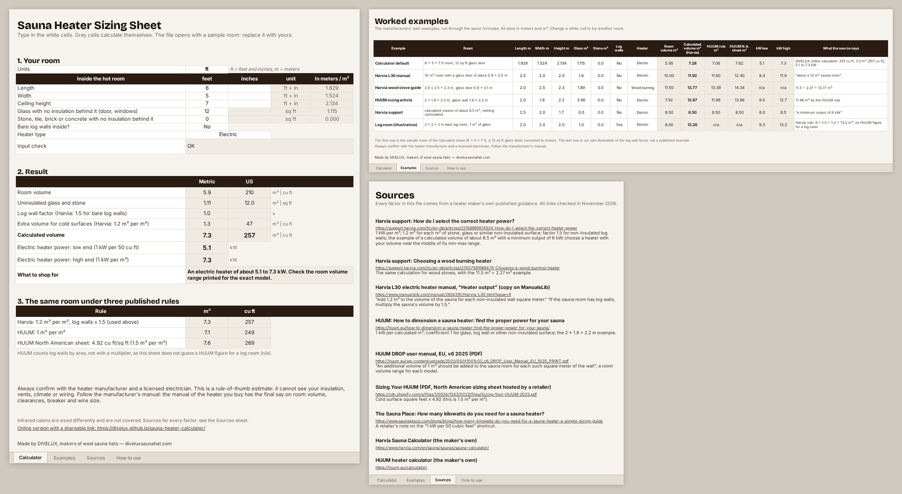

# Sauna Heater Sizing Sheet

Free spreadsheet that sizes a sauna heater from room size, glass and stone area and log walls, using Harvia and HUUM published rules. Feet or meters.

Made by [DIVELUX](https://diveluxsaunahat.com), makers of handmade wool sauna hats. More free sauna tools: https://diveluxsaunahat.com/pages/sauna-tools

## Files

| File | What it is |
|---|---|
| [`sauna-heater-sizing-sheet.xlsx`](sauna-heater-sizing-sheet.xlsx) | the workbook: Calculator, Examples, Sources, How to use |
| [`sauna-heater-sizing-sheet-examples.csv`](sauna-heater-sizing-sheet-examples.csv) | the six worked examples with inputs and results |
| [`preview.png`](preview.png) | rendering of the Calculator, Examples and Sources sheets |

> **Always confirm with the heater manufacturer and a licensed electrician.** This is a rule-of-thumb estimate. It cannot see your insulation, vents, climate or wiring. Follow the manufacturer's manual: the manual of the heater you buy has the final say on room volume, clearances, breaker and wire size.

## How to use

1. Open `sauna-heater-sizing-sheet.xlsx`. The **Calculator** sheet opens with a sample room (6 x 5 x 7 ft with a 12 sq ft glass door). Replace it with yours.
2. Choose the units: `ft` (feet and inches) or `m` (meters). Type length, width and ceiling height measured inside the hot room.
3. Add the area of uninsulated glass, and of stone, tile, brick or concrete with no insulation behind it. Say whether the inside walls are bare log. Pick Electric or Wood-burning.
4. Read the result. The Input check line tells you if a number is missing or out of range (rooms from 0.9 to 6 m a side, ceilings from 1.7 to 3 m, the same limits as the online calculator).

## The rules in the cells

The sheet uses the same rules as the DIVELUX [Sauna Heater Size Calculator](https://divelux.github.io/sauna-heater-calculator/). Every factor comes from a heater maker's published guidance:

| Step | Formula | Source |
|---|---|---|
| Room volume | length x width x height | |
| Cold surfaces | + 1.2 m³ for each m² of uninsulated glass, stone, tile, brick or concrete | Harvia |
| Log walls | room volume x 1.5 if the inside walls are bare log | Harvia |
| Calculated volume | room volume x (1.5 if log) + 1.2 x uninsulated area | Harvia |
| Power, high end | 1 kW per m³ of calculated volume | Harvia, HUUM |
| Power, low end | 1 kW per 50 cu ft (1.416 m³) | retail shortcut; equals Harvia's example of about 8.5 m³ at a minimum of 6 kW |
| Wood-burning stove | calculated volume only: wood stoves are rated by room volume | Harvia |
| Side by side | HUUM: 1 m³ per m². HUUM North American sheet: 4.92 cu ft per sq ft (1.5 m³ per m²). No HUUM figure for a log room | HUUM |

Conversion constants: 1 ft = 0.3048 m, 1 m³ = 35.3147 cu ft, 1 m² = 10.7639 sq ft.

## Sheets

| Sheet | What it does |
|---|---|
| Calculator | Inputs, result, the three-rule comparison, a note when glass and stone are 30% or more of the calculated volume |
| Examples | The manufacturers' worked examples through the same formulas: Harvia L30 manual (10 m³ + glass door, "about 12 m³": 11.9), Harvia wood stove guide (13.77 m³), HUUM article (11.88 m³), Harvia support (about 8.5 m³, minimum 6 kW) |
| Sources | Links to the Harvia and HUUM documents, checked in November 2026 |
| How to use | The method in plain words |

## Checks

`../_build/build_templates.py` recalculates the workbook with the Python package `formulas` and compares the Examples sheet with `heater.js` of the online calculator and with the published results. The sample room gives 210 cu ft, a calculated volume of 7.3 m³ (257 cu ft) and 5.1 to 7.3 kW, the same as the calculator.

## What it does not know

Insulation quality, vents, outdoor temperature, stone mass, altitude, and your home's wiring. Infrared cabins are sized differently and are not covered.

## License

[CC BY 4.0](https://creativecommons.org/licenses/by/4.0/). Free to use, share and adapt. Credit DIVELUX with a link to https://diveluxsaunahat.com.
The DIVELUX name and logo are © DIVELUX Inc. and are not covered by the license.
